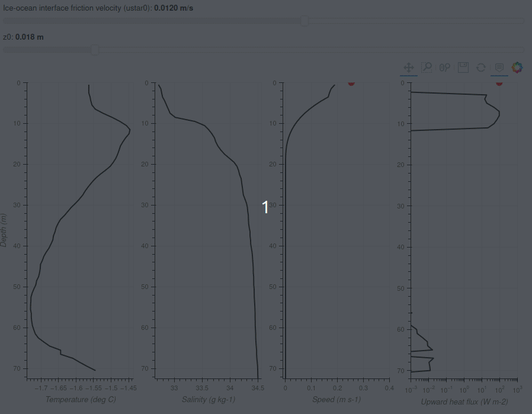

# LOTUS: A 1D local turbulence closure model for the ice-ocean boundary layer

This package implements McPhee's and collaborators' "Local Turbulence Closure" (LTC) model for the ice-ocean boundary layer (see e.g. his 2008 book). Design principles were not speed but rather clarity (as a reference implementation for educational purposes) and modularity (the user can modify specific behaviours or add submodules, e.g., for open water or internal wave scalings).



The basic structure is as follows. `State` saves all variables pertaining to a turbulent oceanic boundary layer. `Model` uses the information in a `state` to predict the vertical profile of turbulence parameters, saving its output in that same state. A `stepper` uses such a `model` to project a `state` into the future (using turbulent mixing coefficients and basic diffusion equations). A `run` (instance of `ModelRun`) then repeatedly applies such a stepper, taking into account variables as prescribed by `forcing`. This may sound more complicated than it is. However, it affords greater modularity.

## Set logging level
```
import param
param.get_logger().setLevel(param.DEBUG)
```

Core dependencies:
- gsw
- numpy
- param

Recommended:
- xarray


